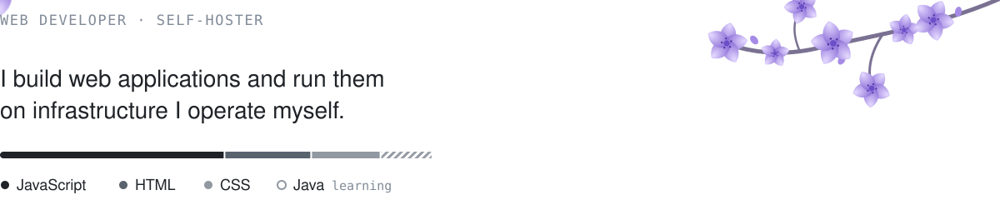
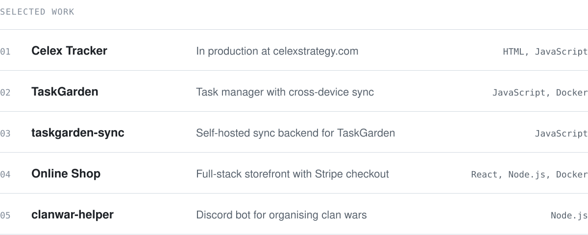
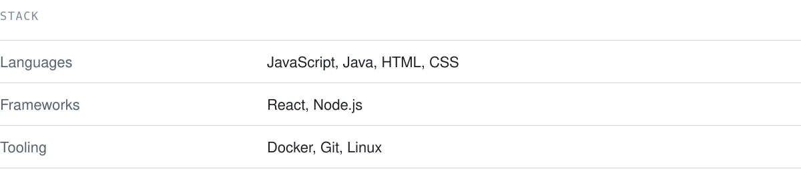

<picture>
  <source media="(prefers-color-scheme: dark)" srcset="assets/intro-dark.svg">
  
</picture>

  

<picture>
  <source media="(prefers-color-scheme: dark)" srcset="assets/projects-dark.svg">
  
</picture>

[celexstrategy.com](https://celexstrategy.com) &nbsp;·&nbsp; [taskgarden-sync](https://github.com/Lxx464/taskgarden-sync) &nbsp;·&nbsp; [CELEX-STRATEGY](https://github.com/CELEX-STRATEGY) &nbsp;·&nbsp; [@lxx464](https://x.com/lxx464)

  

<picture>
  <source media="(prefers-color-scheme: dark)" srcset="assets/setup-dark.svg">
  
</picture>
